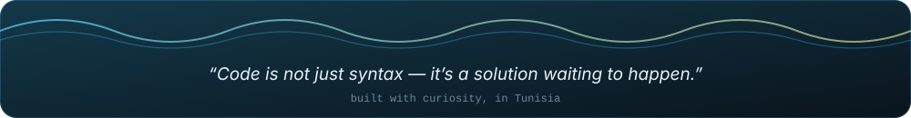

<div align="center">



<br/>


[](https://www.linkedin.com/in/ahmed-kallel-)
[](mailto:ahmed.kallel@etudiant-fst.utm.tn)

</div>


## 01 // About

```ts
const ahmed = {
  name: "Ahmed Kallel",
  from: "Tunisia",
  studying: "Software Engineering @ FST — engineering degree 2024–2027",
  building: ["multi-agent RAG systems", "AI chatbots", "automation workflows"],
  background: ["competitive programming", "distributed systems", "UI/UX"],
  loves: ["fintech", "web platforms", "machine learning"],
  lookingFor: "6-month end-of-studies internship (2027)",
  openTo: "impactful, community-driven collaborations",
};
```

> *I strive to solve real-world problems through innovative solutions and community-driven projects.*



## 02 // Experience

| When | Where | What I built |
|:-----|:------|:-------------|
| `Summer 2026` | **Talan** | *Immobili'IA* — a multi-agent RAG platform, including a legal assistance component |
| `Summer 2026` | **Sofiatech** | HR document automation system |
| `Feb – Apr 2026` | **Citable** *(part-time)* | AI chatbot and automation workflows with **n8n** |
| `Summer 2025` | **Oratio Technologies** | UI/UX and frontend for a legal AI chatbot platform |


## 03 // Community & Leadership

<table>
<tr>
<td width="33%" valign="top">
<h3>📣 Optima JE</h3>
<sub><code>Sept 2024 – June 2026</code></sub>
<p>Marketing Manager of the junior enterprise.</p>
</td>
<td width="33%" valign="top">
<h3>💻 GDG on Campus FST</h3>
<sub><code>2024 – 2025</code></sub>
<p>Competitive Programming Lead.</p>
</td>
<td width="33%" valign="top">
<h3>🥇 IEEE Xtreme 18.0</h3>
<sub><code>Competitive programming</code></sub>
<p>Ranked <b>1st at university level</b>.</p>
</td>
</tr>
</table>


## 04 // Stack

<table>
<tr>
<td width="140"><b>Frontend</b></td>
<td>


</td>
</tr>
<tr>
<td><b>Backend</b></td>
<td>


</td>
</tr>
<tr>
<td><b>AI & Automation</b></td>
<td>


<br/>
<sub><code>RAG</code> · <code>Multi-agent systems</code> · <code>Chatbots</code> · <code>Workflow automation</code> · <code>Machine learning</code></sub>
</td>
</tr>
<tr>
<td><b>Design</b></td>
<td>


</td>
</tr>
<tr>
<td><b>Practices</b></td>
<td>


</td>
</tr>
</table>


## 05 // Selected Projects

<table>
<tr>
<td width="50%" valign="top">
<h3><a href="https://github.com/ahmede9ka/Dinaruis">💰 Dinaruis</a></h3>
<p>B2B crowdfunding platform connecting Tunisian businesses with investors.</p>
<code>HTML</code> <code>JS</code>
</td>
<td width="50%" valign="top">
<h3><a href="https://github.com/ahmede9ka/Dar-Dinar">🏦 Dar Dinar</a></h3>
<p>Financial management app designed specifically for Tunisian users.</p>
<code>PHP</code>
</td>
</tr>
<tr>
<td valign="top">
<h3><a href="https://github.com/Maher-Khemakhem/SNEI3I">🔧 Snei3i</a></h3>
<p>Platform connecting skilled workers with clients in Tunisia.</p>
<code>CSS</code> <code>JS</code>
</td>
<td valign="top">
<h3><a href="https://github.com/ahmede9ka/travel-agency">✈️ Travel Agency</a></h3>
<p>Full travel agency website.</p>
<code>HTML</code>
</td>
</tr>
<tr>
<td valign="top">
<h3><a href="https://github.com/ahmede9ka/Diabetes-Prediction">🩺 Diabetes Prediction</a></h3>
<p>SVM-based machine learning model for diabetes detection.</p>
<code>Python</code> <code>Jupyter</code>
</td>
<td valign="top">
<h3><a href="https://github.com/ahmede9ka/rock-vs-mine-predictor">🪨 Rock vs Mine Predictor</a></h3>
<p>Logistic regression classifier for sonar data.</p>
<code>Python</code>
</td>
</tr>
</table>


## 06 // GitHub Activity

<div align="center">


<br/>

[](https://git.io/streak-stats)


</div>


## 07 // Let's Build Something

Open to collaboration on impactful, community-driven projects — and to a 6-month end-of-studies internship in 2027. If you're working on AI, automation, or fintech problems that matter, say hello.

<div align="center">

[](https://www.linkedin.com/in/ahmed-kallel-)
[](mailto:ahmed.kallel@etudiant-fst.utm.tn)
[](https://github.com/ahmede9ka)

<br/>



</div>
